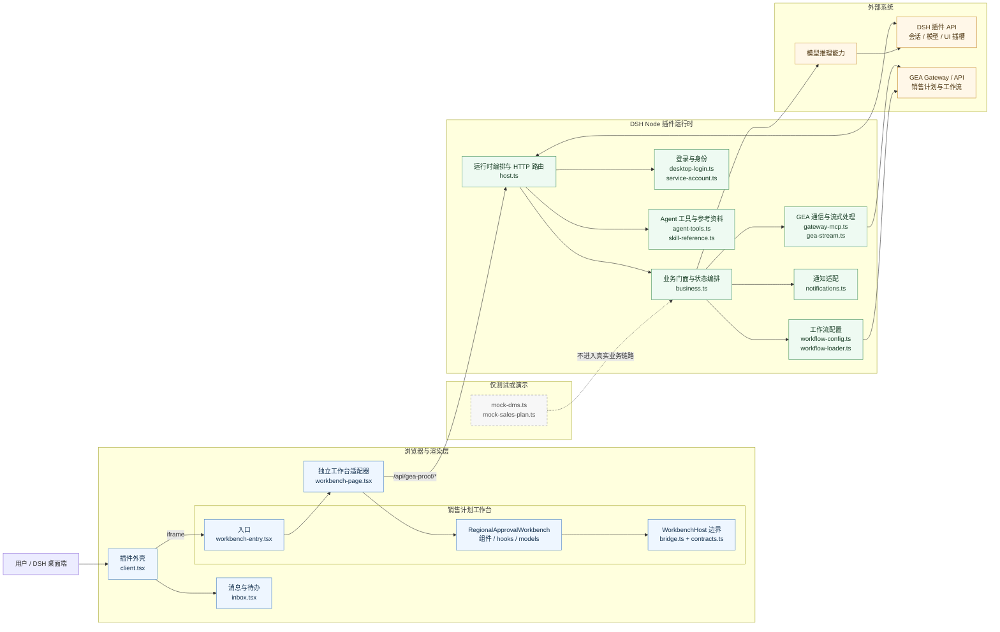

# GEA DSH 插件 `src` 高层组件架构

## System Prompt

基于 Archify 对 `src` 的静态索引结果生成仓库架构说明。严格区分“代码已确认”“架构推断”和“尚未确认”，不把静态依赖关系当作运行时、生产发布或业务验收证据。

## User Prompt

- 分析范围：`src/`
- 产物类型：高层组件架构图
- 视觉风格：简洁架构图
- 阅读目标：看清 UI、Workbench、Host、业务核心与外部 GEA/DSH 能力之间的边界和主要数据流

## Grounded Repository Context

Archify 本次分析了 `src` 下 69 个文件，其中 63 个代码文件进入抽取，生成 1,634 个节点、5,639 条边和 84 个细粒度子系统。下图没有把 63 个代码文件逐一画成节点，而是按运行入口、职责和依赖方向聚合成高层组件。

> 口径说明：界面中的“`src · 63 个文件`”表示进入代码抽取的文件总数；画布只展示聚合后的关键模块，并会隐藏弱连接和低引用节点。因此“文件数”和“可见框数”不会相等。

### 高层架构图

### 组件职责

| 层 | 关键文件/目录 | 主要职责 | 主要下游 |
|---|---|---|---|
| 插件 UI 外壳 | `client.tsx`, `client/inbox.tsx` | 注册 DSH 导航、面板和工作台；展示消息/待办；承载工作台 iframe | `/api/gea-proof/*`、工作台页面 |
| 独立工作台适配 | `workbench-entry.tsx`, `workbench/page.tsx` | 装载 React 工作台，绑定 `WorkbenchHost`，把浏览器请求映射到 Host API | `workbench/original/`, `host.ts` |
| 销售计划工作台 | `workbench/original/` | 查询、筛选、详情、版本比较、导出、审批/退回/保存等交互与前端状态模型 | `bridge.ts` 提供的宿主能力 |
| 插件运行时 | `host.ts` | 创建 `Business`，挂载桌面登录，注册 DSH 工具/模型适配器和 `/api/gea-proof/*` 路由 | `business.ts`、DSH API |
| 业务核心 | `host/business.ts` | 维护环境、身份和认证状态；编排销售计划查询、动作、草稿、提交、通知和分析会话 | GEA 传输、工作流配置、模型能力 |
| 集成适配 | `host/gateway-mcp.ts`, `shared/gea-stream.ts`, `host/service-account.ts`, `host/workflow-config.ts` | 连接 GEA Gateway/API、处理流式响应、服务身份与工作流配置读取 | 外部 GEA 服务 |
| Agent 能力 | `host/agent-tools.ts`, `skill-reference.ts` | 注册受约束的只读工具与参考资料读取能力 | DSH 工具运行时、`Business` |
| 测试/演示 | `mocks/mock-dms.ts`, `mocks/mock-sales-plan.ts` | 为本地测试或演示提供数据 | 不代表真实 DMS/生产链路 |

### 主要调用链

1. DSH 加载 `client.tsx`，插件注册导航、消息面板和销售计划工作台。
2. 工作台 iframe 加载 `workbench-entry.tsx`，由 `workbench/page.tsx` 注入 `WorkbenchHost`。
3. `workbench/original/` 只依赖桥接接口，不直接依赖 DSH 进程或 GEA 网络实现。
4. 浏览器通过 `/api/gea-proof/*` 调用 `host.ts`；Host 把请求交给 `Business`。
5. `Business` 根据当前身份和环境，经 Gateway、工作流配置或模型适配器访问外部能力，再把结果返回 UI。

## Confirmed From Codebase

- `scripts/build.mjs` 定义了三个实际入口：Node 端 `src/host.ts`（同时构建 `src/skill-reference.ts`）、浏览器端 `src/client.tsx`、独立工作台 `src/workbench-entry.tsx`。
- `host.ts` 创建 `Business`、挂载桌面登录、注册 Agent 工具和模型适配器，并注册 `/api/gea-proof/*` HTTP 路由。
- `workbench/page.tsx` 实现并绑定 `WorkbenchHost`，通过 `/api/gea-proof/*` 调用 Host。
- `workbench/original/bridge.ts` 是工作台和宿主之间的显式边界，覆盖 periods、list、detail、versions、logs、versionSkus、compare、action、submit 和 modelInference。
- `workbench/original/README.md` 说明该工作台来自 AionUi 的区域审批工作台，经本地桥接、会话、存储前缀和导入路径适配后嵌入插件。
- Archify 对 `src` 抽取了 63 个代码文件；数据库证据中没有表或 migration，只有 10 个“数据库导向代码路径”候选，不能据此认定插件直接持有数据库。
- `mocks/mock-dms.ts` 和 `mocks/mock-sales-plan.ts` 属于测试/演示路径；当前证据不支持把 DMS 描述为真实集成。

主要证据：`.archify/architecture-context.json`、`.archify/facts.json`、`.archify/modules.json`、`.archify/services.json`、`.archify/dependencies.json`、`.archify/routes.json`、`.archify/database.json`、`.archify/docs-summary.json`、`scripts/build.mjs`、`src/workbench/original/README.md`。

## Inferred Architecture

- 整体更接近“端口与适配器”结构：`workbench/original/bridge.ts` 是浏览器 UI 的端口，`workbench/page.tsx` 和 `host.ts` 共同构成适配层，`host/business.ts` 是业务编排核心。
- `host.ts` 同时承担 HTTP 路由、DSH 生命周期、工具注册和模型适配，属于当前最重要的组合根；后续若继续增大，可按路由、模型和插件生命周期拆分。
- `host/business.ts` 是身份、授权、业务查询和写动作汇合点，修改它的影响面通常会跨越 UI、Host、GEA 请求和测试夹具。
- `workbench/original/` 内部被 Archify 切成多个细粒度子系统，是因为单文件内不同符号簇和模型间存在大量调用；高层图将其合并成一个工作台组件，便于理解而不代表它是单一模块。

以上均为基于静态依赖和文件职责的架构解释，不是运行时追踪结论。

## Questions Before Architecture Generation

已采用的选择：

- 产物：高层组件架构图。
- 风格：简洁架构图。
- 范围：只聚焦 `src/`，外部系统只画边界，不展开内部实现。

未额外指定、因此采用默认值：

- 受众按开发和维护人员处理。
- 不逐文件展开 63 个代码文件；需要时再补一张 `workbench/original/` 内部模型图。
- 不把测试夹具、静态索引或 README 声明升级为生产验收证据。

## Diagram / Image Generation Instructions

- 图的阅读方向为从左到右：用户/DSH UI → 浏览器工作台 → Node Host → 业务与集成 → 外部系统。
- 用蓝色表示浏览器/UI，绿色表示插件 Node 运行时，橙色表示外部系统，灰色虚线表示测试/演示能力。
- 只展示高层组件和关键接口，文件级依赖以 Archify JSON 为准。
- `/api/gea-proof/*` 是浏览器与 Host 的主要跨进程边界；`WorkbenchHost` 是工作台与宿主适配器的主要代码边界。
- 若生成图片版，应保留“63 个抽取文件不等于 63 个可见节点”的说明。

## Open Questions / Uncertainty

- Archify 标记了大量歧义边（本次分析为 4,410 条）；自动推断的跨模块关系应回到源码核对，尤其是 `client.tsx`、`client/inbox.tsx`、`host/business.ts` 与 `workbench/original/` 之间的弱连接。
- 文档摘要检测到 2 个 Markdown 文件，但语义增强未启用且处理文档数为 0；本文件对 `README.md` 的使用属于人工补充阅读，不是 Archify 语义模型结论。
- 当前是静态代码和构建入口证据，未证明远端 GEA 服务、服务身份授权、真实写入、部署同步或业务验收已通过。
- `workbench/original/README.md` 记录：独立适配器的 submission 仍未接通真实服务身份传输；SAVE 的真实后端契约和持久化未被证明；DMS 仍为 mock-only。这些状态可能随后端或发布版本变化，需要用当前部署环境复核。
- Archify 把若干浏览器 API、方法调用和第三方包识别为“外部依赖”，其 1,158 条统计不等同于 1,158 个独立外部服务。
