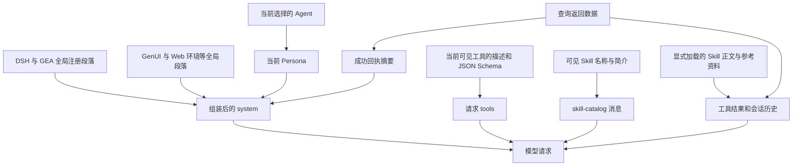

# GEA 全局、Agent、工具与 Skill 提示词审计

日期：2026-09-25。只读分析；没有修改程序、提示词、客户端配置，没有重启客户端、请求模型或调用业务接口。仅新增本报告和统计文件。

## 结论

目前的问题并非仅是提示词太长，而是 **规则由多个地方分别维护，适用范围没有统一声明，真实能力与文字说明更新不同步**。确认了审批规则互相矛盾、旧工具名残留、查询入口冲突、证据复用规则冲突、业务颜色与通用组件颜色冲突，以及大量不必要的常驻上下文。

“刚开始占一半”不能直接判定为所有 Agent/Skill 正文都被一次性加载。实际链路是当前 Agent Persona + 多个全局段落 + 所有当前可见工具定义 + Skill 目录摘要；Skill 正文按需加载，部分业务 Persona 本身就是整篇 Skill。

本报告列出 **28 项问题或风险**，逐项区分当前证据、条件性冲突、历史现象。问题清单不表示已复现每项业务故障，也不表示已经发生越权写入。

## 1. 核查范围和版本

- 当前工作目录：`/Users/synear/Documents/ChatGPT/dsh-gea-plugin`，包版本 `0.0.121`；开始核查时本地 `main` 比已知 `gitlab/main` 落后 45 个提交，结束复核时远端跟踪引用已推进至落后 47 个；本任务没有执行 fetch、切换分支或修改已有文件。原有未提交修改保留。
- 本机选择的插件版本：`0.0.125`，活动组合由 S01 确认。最近真实请求中的 Harness 路径也指向该活动组合。
- 当前 CodeGraph 索引中 `src/host.ts`、`src/html-plugins.ts`、`src/host/agent-tools.ts` 的 SHA-256 均与当前工作区一致。但该索引描述的是旧工作区，不是已安装的 0.0.125。因此以下现状结论以安装包和实际会话记录为主。
- 检查了 7 个可见原生预设、实际会话的 16 项 Skill 目录、业务套件的 2 个角色、实际请求工具定义，并读取了 244 份会话投影元数据；只对相关会话解压核对事件。
- `business-analyst`、`sinian-demand-forecaster` 是业务套件中的代理角色，不是额外两个桌面主 Agent；其正文不会因此自动进入所有父会话。
- 以下数字保留“字符数”和“DSH 估算 token”的区别。没有模型 tokenizer 的实算结果；样本 GEA 请求没有返回可用 usage 或 contextWindow。

## 2. 实际加载链路

需要纠正三种容易误判的情况：

1. 磁盘上有多个副本，不代表同一轮一定加载多次。
2. Skill 目录里有 16 个名字，不代表 16 篇全文都已加载；但目录本身、随后加载的正文都会占用上下文。
3. 一轮用户提问可以包含几十次模型步骤；“才问一个问题”不等于“刚发出第一次模型请求”。

## 3. 上下文占用的实测拆分

最近样本：`session-6cdb67c8-057a-4faf-bb9d-3834f0a998b9`，销售计划 Agent，2026-09-24 创建，实际请求来自当前活动组合。

| 首次模型请求部分 | 字符数 | DSH 估算 token | 说明 |
|---|---:|---:|---|
| 系统提示 | 10,380 | 2,599 | 当前 Persona 和全局段落 |
| 19 个工具定义 | 22,299 | 5,579 | 包括描述及完整参数 Schema |
| 16 项 Skill 目录摘要 | 2,210 | 561 | 目录作为消息注入 |
| 宿主问题提醒 + 2 个子代理角色摘要 | 976 | 261 | 角色摘要，不是角色全文 |
| 首步预置部分合计 | 35,865 | 9,000 | 不含用户原始问题；不是服务端真实 token |

仅看首步预置部分，工具定义占 DSH 估算值约 **62%**。只缩短 Agent Persona，无法解决主要占用。

同一轮第 4 步：系统提示变为 **23,774 字符 / 5,948 估算 token**，较首步增加 13,394 字符；主要新增的是成功查询回执。此时页面操作工具退出目录，工具定义变成 **20,714 字符 / 5,183 估算 token**。所以不能将末步工具分项误作首步大小。

该轮最终投影：system=5,948、tools=5,183、messages=8,071，总计 **19,202 估算 token**。这是一轮已经取数后的结果，并非空会话成本。

### 系统提示内部组成

| 常驻段落 | 字符数 | 判断 |
|---|---:|---|
| DSH身份与销售计划Persona | 2,656 | 应保留身份和任务边界；内部冲突另列 |
| 全局GEA取数协议 | 2,194 | 规则有效但部分细节已由 Schema/宿主校验 |
| 销售计划汇总协议 | 349 | 仅应按销售业务范围生效 |
| 业务位置提示 | 296 | 当前存在旧路由与页面要求冲突 |
| 文件交付格式 | 301 | 业务只读 Agent 不需要文件修改说明 |
| GenUI常驻规范 | 3,172 | 约占首轮系统提示 31%，强制 UI 触发过宽 |
| Harness源码路径提示 | 420 | 业务 Agent 不需要源码 checkout 定位 |
| Web开发环境提示 | 992 | 业务 Agent 不需要 HMR、重建和启动服务器规则 |

### 历史膨胀证据

| 历史样本 | 用户轮数 / 模型步骤 | 最后上下文估算 | 主要现象 |
|---|---|---:|---|
| `6183b361…` | 1 轮 / 27 步 | 62,831 | messages=55,933；销售计划读工具调用 41 次，另有目录和知识库调用 |
| `25922e73…` | 2 轮 / 108 步 | 451,997 | messages=445,253；销售计划读工具调用 178 次，目录调用 21 次 |

这两例来自较早活动组合，证明“少量用户提问被扩展成大量调用/返回”的历史现象；不能据此断言当前版仍能重复到同样次数。当前版本已加入每轮读取计数、聚合入口和停手机制。

尚不能坐实的部分：用户所见“50%”对应的具体会话、当时模型上下文容量、百分比是否由 provider token 校准。没有这些，不能将上述估算值换算成真实占比。

## 4. 当前冲突和失配清单

P1：先消除行为矛盾、错误入口和错误业务表达。P2：减负、明确范围及补足证据。优先级是本次审计建议，不代表已发生生产事故。

| 编号 | 优先级 / 状态 | 问题、两边规则和影响 | 证据 |
|---|---|---|---|
| 01 | P1 明确冲突 | **审批到底能不能执行。** 销售 Persona 第 7 行允许用户明确要求时执行真实通过/退回；第 14 行却要求审批版全程只读、不代点同意/退回。预设简介也承诺不执行业务写入；对话 Skill 更禁止修改草稿或改变工作台。模型无法从文字得到唯一动作边界。 | S03:7、14；S04；S14:27 |
| 02 | P1 明确冲突 | **页面操作工具自己的说明前后矛盾。** 实际 `gea_workbench_apply` 描述先说“不能审批、退回、保存或提交”，后面又说用户本轮明确要求并带 `confirm=true` 可操作提交/审批类元素。样本没有审批类元素，但矛盾对以后提供这些元素的页面仍存在。 | 样本 request/header seq=14 |
| 03 | P1 当前失配 | **分仓和全链仍指向旧页面工具。** Persona 要求 `inventory_fc_page` / `inventory_qll_page`、`name=context`；当前统一入口为 `gea_page`、`action=context`。这两个 Agent 的已存请求目录没有所写旧名字。会诱导猜工具、空调用或拒答。 | S09:10；S10:10；对应历史 request/header；当前统一工具定义 |
| 04 | P1 明确冲突 | **主取数入口有三份版本。** 全局协议要求 Cube 优先 `gea_cube_query`；`gea_gateway_catalog` 的长描述仍教模型走 `gea_module_mcp + query_business_data`；动态“业务位置”也优先教 `gea_module_mcp`。导致新入口已上线，工具仍把模型送回旧路径。 | S02:12659；S07；S08；实际系统提示 |
| 05 | P1 明确冲突 | **主对话要不要读页面。** 销售 Persona 写主对话时不要调用 `gea_page`；动态位置段却写用户明确问“这一屏”时再调 `gea_page`，让工具告诉你页面没开。条件相同，指令相反，产生已知无效调用。 | S03:6；S08；样本 system/message seq=9 |
| 06 | P1 当前失配 | **工具描述引用未暴露工具。** `gea_page` 描述让模型用 `gea_plugin_page_apply` 改页面，但最近样本 19 个工具中没有这个名字；它另有 `gea_workbench_apply`。描述没有按当前页面/会话的可见能力调整。并且通用描述还列 `draft`，多个业务 Skill 明确没有该动作。 | 样本 request/header；S12、S13、S09、S10 |
| 07 | P1 明确冲突 | **证据能否复用。** 销售 Persona 要求“本轮工具返回才是证据”，禁止历史业务事实；对话 Skill 允许复用页面已有事实，只在刷新、改范围或修改回执后重读。既可能反复取数，也可能因遵从另一份规则被判旧证据。缺少共同的来源/范围/版本/失效标准。 | S03:6；S14:14 |
| 08 | P1 条件性冲突 | **局部缺数据是否必须告诉用户。** 全局成功回执要求先交付已有结果再单列缺口；APS 规则明确不列缺失指标、目标、明细和来源。页面简报与业务问答可以采用不同表达，但 APS 规则又明确同时用于右侧会话，适用范围重叠。 | S02:12695；S11:11、24 |
| 09 | P1 条件性冲突 | **查询范围该不该披露。** 全局要求有限明细说清范围、上限、覆盖；销售 Persona/对话 Skill 禁止在默认答复展示查询范围/覆盖范围。隐藏技术标签是合理的，但不能连“仅这 10 家/仅本页”的业务范围一起隐藏。 | S02:12671；S03:8；S14:27 |
| 10 | P1 明确冲突 | **业务颜色与组件默认颜色相反。** 销售 Persona 要求超计划红、低于计划绿；GenUI `stat.delta` 与表格带符号值默认 `+` 绿、`-` 红。用通用 delta 表示计划差额就会违反业务语义；不能只靠再加一句提示。 | S03:15；S20 的 stat/table 说明 |
| 11 | P2 明确冲突 | **一次加载一个 Skill 还是全部。** 销售 Persona 说挑最贴题的一个；Skill 目录公共指令说加载所有适用 Skill。预测、范围确认、基线、复核的描述有交叉，容易扩大单次加载范围。 | S03:5；S21:250 |
| 12 | P1 能力缺口 | **基线 Skill 要求运行 Python，但销售计划预设没有执行入口。** Skill 指定 `scripts/calculate_baseline.py`；样本没有 shell/Python/确定性计算工具。参考读取工具只负责读取链接文件，不能执行。不能据此声称在当前主会话内可按技能完成计算；是否另有授权子代理可执行，未做运行验收。 | S15:16；样本工具目录；销售原生预设 |
| 13 | P2 条件性冲突 | **MCP 资源是否需要再读。** 全局说宿主已内联正文、大结果才读下一段；预测角色和范围 Skill 说收到 resource_link 必须再用资源工具读取。缺少“正文已内联即可使用”的条件，可能重复读取同一数据。 | S02:12680；S17、S18 工具与技能调用段 |
| 14 | P1 业务规则缺口 | **要求百分比，但没声明怎么算。** 销售 Persona 要求写“发货概率 + 百分比”；复核 Skill 又禁止造置信度百分比。六个月活跃月份是证据，不自动构成已校准概率模型。没有可信概率字段或批准算法时，当前格式要求会逼模型凑百分比。未发现规则里有统一兜底。 | S03:9、11；S16 离线评测段 |
| 15 | P2 范围与权威不清 | **阈值/单位写成固定通则。** 销售 Persona 固定 0.9–1.15、60/90 天、±20%、金额为元；全局要求未确认单位不能自标元，业务套件区分待审核字典与本次确认。销售专用口径可以成立，但缺少明确数据来源/适用对象/版本及缺省退路，跨业务取数时容易套错。 | S03:8、15；S02:12674；S18 |

## 5. 当前上下文与维护问题

| 编号 | 优先级 / 状态 | 问题和影响 | 证据 |
|---|---|---|---|
| 16 | P2 已确认 | **开发环境规则进入业务 Agent。** 最近销售请求含源码 checkout、`pwd`、HMR、重建前端、启动服务器、文件改动链接规则，共约 1,713 字符。生成业务建议不需要它们；多数业务 Agent 也没有对应工具。当前只为基地/经销商显式过滤 `app:web-surface` 和销售汇总段，其他业务预设未同等处理。 | S02:12650–12653；S23；实际 system |
| 17 | P2 已确认 | **GenUI 是全局强制工作流，不只是能力说明。** 3,172 字符常驻，几乎任何数字、风险、对比都被要求转换 UI，一条回复要求 3–8 组件，表格/多节点还触发校验。分仓经营洞察要求 100–180 字、固定两段时也会受影响。完整 Skill 另有 18,743 字符，可再次进入历史。 | S19、S20；S09:53 |
| 18 | P2 已确认 | **工具定义没有围绕当前任务收窄。** 19 个首步工具达 22,299 字符，其中 Cube Schema 3,886、模块 MCP 2,449；渲染/校验/visualize 三项合计 4,696。Schema 必要，但通用渲染、所有模块说明和当前查询协议同时常驻，有明显可分层空间。 | 统计 JSON 的 tools |
| 19 | P1 当前冗余入口 | **受管工具与直挂网关工具并存。** 目录同时提供 `gea_cube_query`、`gea_module_mcp` 与直挂 `mcp__gea-gateway__query_business_data` 等。6 个直挂工具的定义约 3,339 字符。除了占用，还允许模型偏离宿主统一校验/结果处理路径；这不等于已经绕过服务端权限。 | 样本 request/header；历史确有直挂调用 |
| 20 | P2 已确认 | **隐藏 Agent 没有同步收窄 Skill/模块清单。** 客户库存、订单工作台、订单履约已隐藏，仍出现在最近销售会话的 Skill 目录及 `gea_module_mcp` 长描述中；它们是演示模块。已有“演示不可取真实数据”说明，但业务模型仍要花上下文和选择成本排除。 | S29；S21；样本 Skill 目录/模块工具描述 |
| 21 | P2 结构性重复 | **Persona 与 Skill 没有分工。** 5 个 HTML Agent 将整篇 Skill（含 frontmatter）写入 Persona，1,149–2,543 字符；销售 Persona 又重复对话 Skill 的取数、两类证据、语言、零值、下一步等规则。销售会话加载 dialogue 后重复已实际发生；HTML Persona 再次加载同 Skill 的重复属于条件性风险，因为这些预设本身通常没有 Skill loader。 | S05；S03；S14；实际 skill 调用 |
| 22 | P1 已确认 | **成功结果又写进 system，明显增大上下文。** 为防止模型忘记已成功取数，回执加入 totals/bases/categoryTotals/groups 等摘要，再注入系统段；样本 system 增长约 13.4k 字符，原工具结果仍在历史中。代码有 24KB 裁剪和条数边界，不能称无限增长，但摘要仍偏大；system 内容变化也不利于稳定前缀复用，缓存影响未实测。 | S06；S02:12689–12695；样本 seq=9→36 |
| 23 | P2 已确认 | **“成功率/占用率”观测不够可靠。** DSH token-meter 用 UTF-16 字符数除 4 加结构开销；最近 provider usage 为空，request/context 未提供 contextWindow，模型适配器也未声明该容量。不能把界面分项当模型真实 token，更不能据此确认 50%。中文密度误差需用实际模型 tokenizer/usage 核对。 | S24；S25；S26；request/context |
| 24 | P2 当前维护风险 | **有效提示词来源分散且同名多份。** 基地/经销商取安装包 presets 的托管正文；其他页面 Agent 取 HTML 包 Skill；随后生成 home/skills、gea-business-skills、native-presets。不是所有副本都首轮重复加载，但改错文件会无效/被覆盖，按 Agent 名定位不够。 | S05；S01；安装目录 |
| 25 | P2 预设范围风险 | **“智能编排”实际是完整编码 Agent。** 挂载 Shell、文件、默认个人开发 Skill、计划/目标、子代理、工作流；描述本身也写编码 Agent。若用户把它当业务自动编排入口，会继承大量无关能力和规则。最近可用历史样本有 37 个工具、34 项 Skill；这不是当前销售预设的目录。 | S27；对应历史请求；S22 |
| 26 | P2 参考资料加载风险 | **按需资料仍可能整块进入上下文。** 基线/复核/范围 Skill 的“先读”链路会引入多份参考资料；业务字典正文 27,862 字符，规则与冲突 1,768、数据约定 2,320、模板 799。参考工具有行数/32,000 字符限制，故不是无界读取；但缺少按当前业务问题指定章节的统一入口。 | S15–S17；套件 references；参考读取工具 |
| 27 | P1 历史已证实、当前部分缓解 | **一轮扩成大量查询，历史结果挤爆上下文。** 1 轮 27 步、41 次销售读；另例 2 轮 108 步、178 次销售读。当前已新增 aggregate、每轮计数、目录复用和停手，不把过去次数当现版事实。仍需以后用真实任务验证“查询数/结果体积/停止条件”，不能只验证提示词更短。 | 两个历史会话；安装 host.js:7302–7305 |
| 28 | P2 有观测、因果待验证 | **年月解析缺少清晰的当前日期依据。** 最近样本先查询 2025-09，再改查 2026-09；该首轮系统中没有明确统一的“今天/当前年”事实段，业务 Persona 设置 includeRuntimeContext=false。能确认多出一次错误期间查询；尚不能仅凭这一例认定完全由日期提示缺失导致。 | 样本 tool/call step=1、2；S03 的 runtime 配置 |

## 6. 按 Agent 对照

| 可见 Agent | 正文来源 / 大小 | 当前主要问题 | 备注 |
|---|---|---|---|
| 智能编排 | auto-negotiation 编码预设 | 25；并继承通用工具/Skill/GEA 全局规则 | 属于编码能力，不能与只读业务 Agent 混为一类 |
| 销售计划 Agent | presets/gea-readonly，Persona 2,604 字符 | 01、02、04–07、09–15、16–23 | 最近真实请求证据最完整 |
| 产销协同 Agent | 页面 Skill 整篇，2,202 字符 | 08、16–22；固定页面分析边界与全局范围取数边界未明示优先关系 | “禁止主动补数”是其业务意图，不能未经确认删除 |
| 全链库存管理 Agent | 页面 Skill 整篇，1,149 字符 | 03、04、06、16–22 | 仍把先读页面作为固定首步；独立范围查询边界需说明 |
| 基地库存 Agent | 安装包托管 Skill，1,602 字符 | 04、18–24；仍受通用 UI 和工具说明影响 | 已区分页面/独立查询，已允许部分成功结果交付；这两点不要回退 |
| 分仓库存 Agent | 页面 Skill 整篇，2,543 字符 | 03、04、06、16–22；短洞察与全局 UI 输出结构重叠 | 公式与数据边界是有效业务规则，不应为省 token 一并删掉 |
| 经销商库存 Agent | 安装包托管 Skill，2,310 字符 | 04、18–24；同名旧页面 Skill 与托管源并存 | 当前生成配置已核对；缺少本活动组合下有内容的经销商请求样本，不宣称已做运行验收 |

注意：销售计划 Persona 的强制“每轮 2–3 个下一步”没有证据证明会自动注入所有 HTML Agent。因此不把它与分仓“无下一步”直接判成同一会话的硬冲突；分仓实际共同继承的是全局 GenUI。

## 7. Skill 和角色覆盖

最近销售会话可见 16 个 Skill：

| Skill / 组 | 本次检查结果 |
|---|---|
| sinian-demand-dialogue | 已读取正文并核对实际加载；与 Persona 在审批、修改、证据复用、范围展示上有冲突/重复 |
| sinian-forecast-scope | 已读取；实体/候选规则应保留，参考资料和资源读取规则需对齐宿主 |
| sinian-demand-baseline | 已读取；Python 执行能力缺口，公式前提与不能凭空算数的边界应保留 |
| sinian-forecast-review | 已读取；不造置信度、分清评测与公司考核是有效约束；与统一百分比要求需要协调 |
| business-requirements-brief | 已读取；自身未发现明显硬冲突；不是日常取数的默认入口 |
| inventory-apsplan / aqkc / dealer / fc / qll | 已读当前有效来源；见逐 Agent 表 |
| inventory-personal-workbench | 已读取；工作台上下文、无持久化、无历史差分的边界清楚；仍在销售会话目录中 |
| inventory-customer / orderworkbench / orderfulfillment | 已读取；明确是演示范围；主要问题是隐藏后仍参与业务会话发现 |
| genui | 已读取常驻规则、完整文件尺寸及主要组件契约；触发范围、颜色和自动求和语义与业务规则需协调 |
| visualize | 核对工具 Schema/描述和目录触发；要求首次调用前加载 Skill，与 GenUI 有呈现职责重叠。本次没有进一步执行或逐段审查其完整正文 |

业务套件的 `business-analyst` 正文说明未接入系统、不声称已查询，未发现自身硬冲突。`sinian-demand-forecaster` 已读取全部正文，明确只生成草案、要求按需加载技能；需对齐宿主的资源已内联规则、概率口径与可执行能力。套件声明使用待业务审核字典，不应被全局提示悄悄升级成正式业务规则。

## 8. 工具提示词体积清单

以下是首步真实请求的工具 JSON 定义字符数，不是返回数据大小，也不是 tokenizer 实算值。

| 工具 | 定义字符数 | 描述字符数 |
|---|---:|---:|
| `gea_cube_query` | 3,886 | 117 |
| `gea_gateway_catalog` | 1,682 | 984 |
| `gea_module_mcp` | 2,449 | 1,556 |
| `gea_page` | 746 | 381 |
| `gea_sales_plan_read` | 1,866 | 610 |
| `gea_skill_reference_read` | 457 | 165 |
| `gea_visible_workbench_context` | 648 | 455 |
| `gea_workbench_apply` | 1,584 | 544 |
| `mcp__gea-gateway__dsh_read_resource` | 361 | 166 |
| `mcp__gea-gateway__gateway_session_currentUser_resol_23e1fd5dce66` | 217 | 35 |
| `mcp__gea-gateway__lightrag_list_docs` | 257 | 145 |
| `mcp__gea-gateway__lightrag_query` | 863 | 607 |
| `mcp__gea-gateway__lightrag_query_data` | 1,056 | 697 |
| `mcp__gea-gateway__query_business_data` | 585 | 40 |
| `render_ui` | 1,708 | 520 |
| `skill` | 376 | 183 |
| `subagents_run` | 550 | 251 |
| `validate_dsh_ui` | 1,079 | 645 |
| `visualize` | 1,909 | 621 |

Schema 中的枚举、类型、授权边界不是应该无差别删除的废话。优先处理已经错误的描述、重复入口、无关工具和整模块目录，再考虑紧凑表达。

## 9. 已有改善，不应当成尚未修复

1. 销售计划预设已设置 `includeDefaultRoots: false`，使用业务 Skill 目录。旧样本 Skill 目录有 34 项、5,918 字符；当前样本是 16 项、2,210 字符。不能继续笼统说“当前销售计划首轮仍加载所有个人开发 Skill”。智能编排另论。
2. 全局 Cube 协议已优先新受管入口，参数已结构化；旧版只许若干键、不支持 segments 的描述不是当前全局正文。当前残留问题在工具目录和业务位置等其他层。
3. 基地和经销商的托管 Skill 已明确页面关闭不妨碍独立查询、授权拒绝不换身份、局部失败不抹掉成功结果。
4. 已有大结果分段、明细限额、成功回执边界、读取计数和停手规则。问题是各机制仍需统一预算及真实任务验收，不能说完全没有保护。

## 10. 处理顺序建议（本次未实施）

1. 先确定三件业务决定：哪些 Agent 可执行真实动作；哪些场景必须披露缺口；概率、阈值和颜色以哪个业务定义为准。01、08–10、14–15 不能只当文字润色。
2. 对齐工具契约：旧工具名、主入口、页面工具可见性、审批确认语义、Skill 的计算能力。优先 02–06、12。
3. 分离常驻规则与按需规则：只保留身份、权限、证据和输出的最小公共约定；业务规则归对应 Agent/Skill，具体形状归工具 Schema，UI 大手册按需取。
4. 缩小成功回执，只保存必要索引和结论证据；避免 system 再复制成块业务表，同时保留“局部失败不抹掉成功结果”的行为。
5. 验收应分别记录首步固定占用、首轮结束占用、调用数、最大工具结果、真实 provider token 和窗口容量；同时检查答案业务正确性、动作边界和页面效果。

待核实：原“50%”会话及模型容量；当前各 Agent 新会话的完整运行对照；概率/阈值的业务批准来源；子代理是否有经授权的确定性计算入口。这里只是审计结论，不因缺少这些额外证据阻断已确认问题的列举。

## 11. 可追溯证据索引

- **S01** [活动插件选择](</Users/synear/Library/Application Support/dsh-gea-desktop/plugins/selection.json:1>)
- **S02** [GEA 全局注入和按预设过滤](</Users/synear/Library/Application Support/dsh-gea-desktop/plugins/versions/channel-12c7927e-1771-4e2c-b58d-e206f2a3cae5/node_modules/@cleverc2200/gea-dsh-prototype/lib/host.js:12650>)
- **S03** [销售计划 Persona](</Users/synear/Library/Application Support/dsh-gea-desktop/plugins/versions/channel-12c7927e-1771-4e2c-b58d-e206f2a3cae5/node_modules/@cleverc2200/gea-dsh-prototype/presets/gea-readonly/agent.cordis.yml:5>)
- **S04** [销售计划预设简介](</Users/synear/Library/Application Support/dsh-gea-desktop/plugins/versions/channel-12c7927e-1771-4e2c-b58d-e206f2a3cae5/node_modules/@cleverc2200/gea-dsh-prototype/presets/gea-readonly/preset.yml:1>)
- **S05** [托管 Skill 选择及整篇注入 Persona](</Users/synear/Library/Application Support/dsh-gea-desktop/plugins/versions/channel-12c7927e-1771-4e2c-b58d-e206f2a3cae5/node_modules/@cleverc2200/gea-dsh-prototype/lib/host.js:9555>)
- **S06** [成功聚合回执摘要](</Users/synear/Library/Application Support/dsh-gea-desktop/plugins/versions/channel-12c7927e-1771-4e2c-b58d-e206f2a3cae5/node_modules/@cleverc2200/gea-dsh-prototype/lib/host.js:7333>)
- **S07** [取数目录工具描述](</Users/synear/Library/Application Support/dsh-gea-desktop/plugins/versions/channel-12c7927e-1771-4e2c-b58d-e206f2a3cae5/node_modules/@cleverc2200/gea-dsh-prototype/lib/host.js:11894>)
- **S08** [业务位置提示](</Users/synear/Library/Application Support/dsh-gea-desktop/plugins/versions/channel-12c7927e-1771-4e2c-b58d-e206f2a3cae5/node_modules/@cleverc2200/gea-dsh-prototype/lib/host.js:2366>)
- **S09** [分仓 Skill](</Users/synear/Library/Application Support/dsh-gea-desktop/data/html-plugins/inventory-fc/skills/fc/SKILL.md:10>)
- **S10** [全链 Skill](</Users/synear/Library/Application Support/dsh-gea-desktop/data/html-plugins/inventory-qll/skills/qll/SKILL.md:10>)
- **S11** [产销协同 Skill](</Users/synear/Library/Application Support/dsh-gea-desktop/data/html-plugins/inventory-apsplan/skills/aps/SKILL.md:10>)
- **S12** [经销商托管 Skill](</Users/synear/Library/Application Support/dsh-gea-desktop/plugins/versions/channel-12c7927e-1771-4e2c-b58d-e206f2a3cae5/node_modules/@cleverc2200/gea-dsh-prototype/presets/inventory-dealer.skill.md:1>)
- **S13** [安全库存托管 Skill](</Users/synear/Library/Application Support/dsh-gea-desktop/plugins/versions/channel-12c7927e-1771-4e2c-b58d-e206f2a3cae5/node_modules/@cleverc2200/gea-dsh-prototype/presets/inventory-aqkc.skill.md:1>)
- **S14** [需求预测对话 Skill](</Users/synear/Library/Application Support/dsh-gea-desktop/data/home/agent-plugins/.sources/company-agent-suites/suites/sinian-demand-forecast/skills/sinian-demand-dialogue/SKILL.md:12>)
- **S15** [预测基线 Skill](</Users/synear/Library/Application Support/dsh-gea-desktop/data/home/agent-plugins/.sources/company-agent-suites/suites/sinian-demand-forecast/skills/sinian-demand-baseline/SKILL.md:8>)
- **S16** [预测复核 Skill](</Users/synear/Library/Application Support/dsh-gea-desktop/data/home/agent-plugins/.sources/company-agent-suites/suites/sinian-demand-forecast/skills/sinian-forecast-review/SKILL.md:1>)
- **S17** [预测范围 Skill](</Users/synear/Library/Application Support/dsh-gea-desktop/data/home/agent-plugins/.sources/company-agent-suites/suites/sinian-demand-forecast/skills/sinian-forecast-scope/SKILL.md:1>)
- **S18** [预测分析员角色](</Users/synear/Library/Application Support/dsh-gea-desktop/data/home/agent-plugins/.sources/company-agent-suites/suites/sinian-demand-forecast/agents/sinian-demand-forecaster.md:1>)
- **S19** [GenUI 常驻全局提示](</Users/synear/Library/Application Support/dsh-gea-desktop/plugins/versions/channel-12c7927e-1771-4e2c-b58d-e206f2a3cae5/node_modules/@changfenhuang/dsh-genui/lib/index.js:3700>)
- **S20** [GenUI 完整 Skill](</Users/synear/Library/Application Support/dsh-gea-desktop/plugins/versions/channel-12c7927e-1771-4e2c-b58d-e206f2a3cae5/node_modules/@changfenhuang/dsh-genui/SKILL.md:1>)
- **S21** [Skill 目录注入规则](</Users/synear/Library/Application Support/dsh-gea-desktop/plugins/versions/channel-12c7927e-1771-4e2c-b58d-e206f2a3cae5/node_modules/@deepseek-ai/dsh-tool-skill/lib/index.js:238>)
- **S22** [Skill 默认扫描根](</Users/synear/Library/Application Support/dsh-gea-desktop/plugins/versions/channel-12c7927e-1771-4e2c-b58d-e206f2a3cae5/node_modules/@deepseek-ai/dsh-skill-filesystem/lib/index.js:152>)
- **S23** [Web 开发环境提示](</Users/synear/Library/Application Support/dsh-gea-desktop/plugins/versions/channel-12c7927e-1771-4e2c-b58d-e206f2a3cae5/node_modules/@deepseek-ai/dsh-web-app/lib/index.js:91>)
- **S24** [token 估算算法](</Users/synear/Library/Application Support/dsh-gea-desktop/plugins/versions/channel-12c7927e-1771-4e2c-b58d-e206f2a3cae5/node_modules/@deepseek-ai/dsh-token-meter/lib/index.js:15>)
- **S25** [GEA 模型元数据](</Users/synear/Library/Application Support/dsh-gea-desktop/plugins/versions/channel-12c7927e-1771-4e2c-b58d-e206f2a3cae5/node_modules/@cleverc2200/gea-dsh-prototype/lib/host.js:12395>)
- **S26** [最近会话投影](</Users/synear/Library/Application Support/dsh-gea-desktop/data/home/storages/session_projcache/sessions/session-6cdb67c8-057a-4faf-bb9d-3834f0a998b9.json:1>)
- **S27** [智能编排原生预设](</Users/synear/Library/Application Support/dsh-gea-desktop/data/native-presets/auto-negotiation/agent.cordis.yml:1>)
- **S28** [业务 Skill 套件安装状态](</Users/synear/Library/Application Support/dsh-gea-desktop/data/home/agent-plugins/state.json:1>)
- **S29** [隐藏预设清单](</Users/synear/Library/Application Support/dsh-gea-desktop/plugins/versions/channel-12c7927e-1771-4e2c-b58d-e206f2a3cae5/node_modules/@cleverc2200/gea-dsh-prototype/presets/agent-presets.json:1>)

- 原始样本会话（Zstd，未复制业务数据）：[session-6cdb67c8-057a-4faf-bb9d-3834f0a998b9](</Users/synear/Library/Application Support/dsh-gea-desktop/data/home/sessions/--Users-synear-Library-Application~0020Support-dsh-gea-desktop-data-workspace--/session-6cdb67c8-057a-4faf-bb9d-3834f0a998b9/session.v3.jsonl.zstd>)
- [可机器读取的统计](/Users/synear/Documents/ChatGPT/dsh-gea-plugin/docs/analysis/prompt-audit-2026-09-25-metrics.json)仅含提示词尺寸、工具/技能名字和路径，不含业务查询结果、用户问题、登录凭据。
