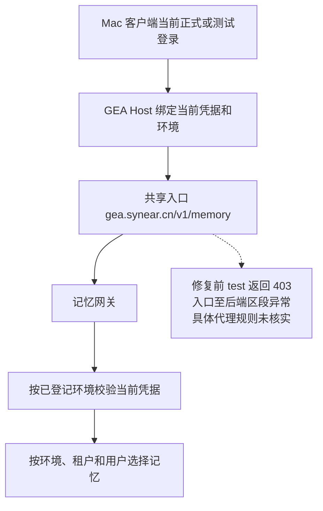

# 测试记忆 403 故障取证与恢复验收

2026 年 11 月 17 日 16:58，真实正式、测试登录的记忆读取和环境隔离验收通过。验收后已恢复 Mac 客户端原正式登录。本文记录当次结果，时间使用台北时区。

## 问题

用户在排查正式和测试接口混用时，发现真实测试登录的销售计划可读取，个人记忆却返回 `403 PROXY_FORBIDDEN`。记忆使用共享 HTTPS 入口，单看域名无法判断访问归属；既有环境隔离实现见 [GEA PR #431](https://github.com/CleverC2200/dsh-gea-plugin/pull/431)，当前接口合同见[个人记忆网关合同](protocol.md)。

用户提供的 2026 年 11 月 2 日操作手册描述单套记忆部署，接入探针固定使用 `production`，未验收 `test`。手册同时写明按环境、租户和用户区分归属，但未提供实际 NGINX 路由。它不能证明近期改过代理，也不能确定哪条规则造成 403。

## 现象

13:49 对公网入口使用同一路径、方法及空请求体，仅改变 `X-GEA-Environment`，与 13:46 直连记忆网关的结果对比如下。

| 无凭据请求 | 公网入口 HTTP / 错误码 | 后端直连 HTTP / 错误码 |
| --- | --- | --- |
| `production` | 401 / `MEMORY_UNAUTHENTICATED` | 401 / `MEMORY_UNAUTHENTICATED` |
| `test` | 403 / `PROXY_FORBIDDEN` | 401 / `MEMORY_UNAUTHENTICATED` |
| 未登记环境 | 403 / `PROXY_FORBIDDEN` | 400 / `MEMORY_INVALID_REQUEST` |

真实测试凭据在公网也返回同一 403。已核实的后端活动配置登记了正式、测试两个身份校验上游，其源码没有 `PROXY_FORBIDDEN`。因此，故障范围收窄到公网入口至已核实后端之间；实际代理配置和命中规则仍未取得。



## 做了什么

1. 在正式 Mac 客户端分别用正式登录和飞书扫码建立的真实测试登录读取销售计划及记忆，没有用正式凭据改环境标签冒充测试登录。
2. 对照公网、后端直连、活动环境配置及代码历史，保留修复前原始报文。记忆请求携带环境的代码可追溯到 [2026 年 11 月 2 日提交](https://github.com/CleverC2200/dsh-gea-plugin/commit/a226bcceb)，不是本次隔离改动首次引入。
3. 用户联系入口代理维护者处理。随后复测入口，再完成真实双环境读取、双向凭据错配、测试读取正式条目及浏览器伪造归属的检查。
4. 恢复原正式登录，实际复核身份与记忆，再移除诊断启动参数，正常启动 Mac 客户端。核对原会话、草稿、登录文件和记忆归属账本。

本轮没有修改服务器代理配置、数据库或容器，也没有业务提交、记忆生成、编辑、删除或清空。

## 结果

16:48 无凭据复测时，正式和测试均返回 `401 MEMORY_UNAUTHENTICATED`，未登记环境仍返回 `403 PROXY_FORBIDDEN`。随后使用真实凭据完成以下验收。

| 验收项 | 结果 |
| --- | --- |
| 正式销售计划 | 实际请求 origin 为 `https://gea.synear.cn`，HTTP 200 |
| 测试销售计划 | 实际请求 origin 为 `https://gea.synear.cn:4443`，HTTP 200 |
| 正式记忆 state、list | 成功，返回 `production`，租户和用户匹配当前登录 |
| 测试记忆 state、list | 成功，返回 `test`，租户和用户匹配当前登录；列表为空 |
| 测试凭据标记为正式环境 | HTTP 401，`MEMORY_UNAUTHENTICATED`，未返回记忆 |
| 正式凭据标记为测试环境 | HTTP 401，`MEMORY_UNAUTHENTICATED`，未返回记忆 |
| 测试身份读取已知正式条目 | 网关 HTTP 404，`MEMORY_NOT_FOUND`，未返回条目 |
| 浏览器提交伪造 scope | Host 拒绝，`MEMORY_INVALID_REQUEST` |
| 正式记忆保留 | 切换前后均为 1 条、revision 11、bankGeneration 2 |
| 恢复正式 | 原正式用户、租户和 `production` 已认证状态均实际复核，客户端正常启动 |

记忆条目不存在时，Host 外层业务封装的 HTTP 可以是 200，但其 `ok=false`；上表的 404 指实际记忆网关响应。测试记忆为空只证明本次读取结果，不代表已验收生成、编辑或删除。

### 原数据保留

本轮核对的 142 个原文件全部存在，其中 139 个字节未变。其余三处为 Core 初始化引起的会话日志、派生缓存及工作区索引更新。

- 原会话日志的五条记录完整保留为前缀，仅追加 `session/end-seed`。
- 派生缓存更新序号及初始化状态。
- 原 43 个工作区会话保持原相对顺序，新增一个空白会话。

原审批草稿、正式登录文件和记忆归属账本字节未变。没有覆盖上述运行状态文件。

### 证据范围

原始 HTTP、客户端调用结果、双向错配检查、数据差异和恢复副本保留在本次任务本机的 `.runtime/mac-memory-fixed-acceptance-20261117-1648/`；修复前失败证据保留在 `.runtime/memory-test-403-repair-20261117/`。这些目录不是仓库共享附件，其中恢复副本包含凭据和用户数据，未随本文上传。

本文提供可共享的观测摘要。源码门禁、包发布、GitHub Windows 验证和 Mac 真实登录验收分别留证；个人 Windows 设备未在本轮连接或验收。

## 需要怎么协助

入口行为和真实双环境读取已经恢复，本次读取与隔离验收没有阻断项。代理维护者仍可补充实际接入主机、配置来源、命中规则及修复差异，完成配置根因追溯。现有证据不足以判断该规则是历史限制、配置遗漏还是后续回退。

如再次出现 403，可从获授权的网络使用下面的无凭据请求检查入口。正常情况下，已登记的正式、测试环境应进入身份校验并返回 401；无凭据结果本身不替代真实登录验收。

```sh
curl --silent --show-error --include \
  --request POST 'https://gea.synear.cn/v1/memory/state' \
  --header 'Content-Type: application/json' \
  --header 'X-GEA-Environment: test' \
  --data '{}'
```
