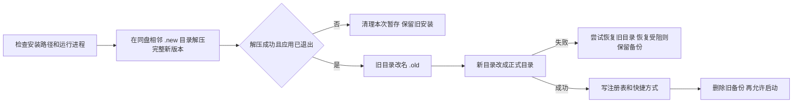

# DeepSeek 官方客户端：更新、下载、安装与存储对照

研究时间：2026-09-27。本文保留研究时点的对照结论；随后用户授权按推荐方案实施，当前进度和验证边界见 [实施记录](../desktop-install-storage-implementation-20260927.md)。未升级官方核心或推进正式频道。

## 结论

优先借鉴三件事：**安装时整目录切换并保留失败恢复机会；不可变核心与用户插件分离；下载缓存按角色保留和清理。** 我方完整插件历史图的回收仍需独立补齐。官方仍使用 Electron + NSIS，不是换成 MSIX 才解决问题。我们的同盘移动候选方向与官方一致，但官方同路径升级保护完整旧安装目录，比当前候选只对顶层条目尝试移动更完整。

不能直接替换的部分：官方核心与桌面同版本发布、Electron Node-mode 与运行时解析、第三方插件原地安装、签名更新元数据，以及卸载时的数据归属。我们独立发布 GEA 插件、保留整图回退和业务数据，这些契约需要保留或明确迁移。[安装适配代码][install-adapter]、[打包配置][builder]、[官方运行说明][readme]

## 1. 本次核对的是哪个“官方”

| 对象 | 已核实结果 |
| --- | --- |
| 官方项目 | `deepseek-ai/deepseek-harness/apps/desktop`，未采用社区 dsh-desktop / DSH-X 的结论 |
| 本次查询 master | `477b4f420553e8a52c2fbccc464d7561b239c443`，提交时间 2026-09-24 13:39:59 UTC |
| 源码桌面版本 | `@deepseek-ai/dsh-desktop` 0.1.7-rc.2 |
| Windows 公开 feed | `https://download.deepseek.com/dsh-desk/feeds/win-x64/nightly.yml`，返回 0.1.7-rc.2 |
| Windows 实包 | 完整下载 288,245,480 bytes，SHA-512 与 feed 相同；未执行该 EXE |
| Windows 实包 SHA-256 | `0cf065dc2fc56456448620230581a9072477f0b2562bbc4e1709cdaedd3ceb86` |
| 实包内嵌构建身份 | `dshBuildCommit=c1275515b6b97551ec358c926c479ab750c687c0`，`dshBuildDirty=false` |
| 源码与实包对应边界 | 公开 GitHub compare 上述内嵌 commit 与 master 返回 404，未证明两者源码逐字一致；机制分析绑定 master，包内布局/元数据绑定已发 EXE |
| macOS Apple Silicon | nightly-mac.yml 返回 0.1.7-rc.2；ZIP 清单可读，DMG HEAD 200 |
| macOS Intel | 本轮该目标 nightly-mac.yml 返回 404；不能因为源码支持该目标就宣称已开放下载 |

官方公开包是预览版，生产下载域名仍使用 `nightly` feed 名称，不应将其表述成稳定版。入口：[固定源码提交][commit]、[Windows 官方清单][win-feed]、[Windows 官方 EXE][win-exe]、[macOS ARM 清单][mac-feed]。

## 2. Windows 安装：值得直接借鉴的重点

### 实际流程

- `directoryInstallSection` 只改固定 26.15.3 模板的明确锚点，保留标准注册、快捷方式与卸载入口；同路径升级跳过旧卸载器，迁移安装位置仍走旧卸载器路径。[源码][install-adapter]
- 暂存目录是安装目录的同级 `.new-GUID`，旧版改名为 `.old-GUID`；新目录提升失败时尝试把旧目录改回来。恢复被进程占用阻止时保留备份，不假装已经恢复。[源码][directories]
- 解压使用随包的 7za.exe，由原生 helper 监管子进程并收集退出码；只有 0 才继续。不是 Nsis7z 提取后再 CopyFiles。子进程放入 Job Object，避免安装进程退出后仍留着解压子进程。[源码][extract]
- 启动、路径选择后、替换前检查进程；按目标可执行文件完整路径识别，避免误处理同名其他程序。更新启动允许等应用退出约 10 秒，超时阻止安装。[源码][installer-running]、[进程识别][process]
- 校验路径归属、可写性、磁盘剩余空间及 reparse point。新目录必须为空，非空目标必须是已登记安装，避免把用户任意目录当应用目录替换。[源码][path]
- 提供解压失败日志，保留原生退出码和完整错误输出；界面只展示首要错误并允许复制详情。[源码][extract-report]

### 对我们当前候选的意义

| 项目 | 我们已完成的候选 | 官方做法 | 借鉴判断 |
| --- | --- | --- | --- |
| 重复复制 | 同盘子目录解压，尝试移动顶层条目，剩余项走原复制 | 相邻目录完整解压，整目录切换 | 当前提速成果保留；后续升级为整目录替换 |
| 旧版保护 | 沿用旧卸载器；没有完整旧目录恢复承诺 | 同路径先保留旧目录，提升失败尝试恢复 | 优先补齐，尤其适合覆盖升级 |
| 解压失败 | 沿用现有 Nsis7z/兜底路径 | 严格检查 7za 子进程退出码和错误报告 | 可以借鉴独立解压结果门槛 |
| 旧残留 | 保留未知内容、已有目标时退回复制 | 目标归属明确后替换整目录，可移除旧版多余文件 | 需要先做归属保护，不能直接删整个用户目录 |
| 安装范围 | 公司现有安装范围需兼容 | 仅当前用户，拒绝已有全用户安装 | 不直接复制这个限制，先覆盖公司已有 HKCU/HKLM 迁移 |

官方的“安装失败恢复”不能扩大解释为“新程序启动失败后恢复旧 EXE”：其正常路径在启动前已删除旧备份。强制断电或删除备份受阻仍可能留下 `.new-*` / `.old-*`，不是永久零残留。[目录实现][directories]、[当前用户限制][installer-scope]

官方配套原生 smoke 覆盖首次安装、升级、锁定文件、提升源缺失、坏压缩包、取消和长路径，并检查旧内容是否保留、旧版独有文件是否移除、失败日志是否齐全。本轮阅读了这些测试，没有执行它们，也没有实测官方包安装时间。[原生测试][native-tests]

## 3. 打包：同样是 Electron，为什么零散文件更少

官方 `files` 将核心 dsh 及生产依赖装入 `app.asar/dsh`，原生模块/PE/外部执行工具根据实际需求解包，并校验归档内外清单与字节。Host 使用 Electron 的 Node-mode，核心不在首次启动时由 pnpm 安装到用户 profile。[打包配置][builder]、[Windows 解包验证][unpack]、[运行说明][readme]

我们虽然也设置了 `asar:true`，但主要只把壳文件放入 ASAR；整个 payload 和 node_modules 都属于 extraResources，仍是零散文件。现有独立 Node 启动与插件复制流程不能直接读取任意 ASAR，因此不能只改一个 `asar:true` 开关。

本轮用同一归档读取工具核对两个实际 Windows 安装包：

| 指标 | GEA 0.0.22 | 官方 0.1.7-rc.2 |
| --- | ---: | ---: |
| EXE 大小 | 264,420,852 bytes | 288,245,480 bytes |
| 内嵌应用展开后实体文件 | 24,202 | 9,764 |
| 上述文件内容总量 | 828,142,268 bytes | 1,058,538,220 bytes |
| 核心放置 | resources/payload 中零散依赖 | app.asar 中为主，原生资源在外 |

官方 app.asar 大小约 117 MB，包含 11,380 个归档内文件条目，另有 1,495 个 unpacked 条目；这些虚拟条目没有全部变成单独落盘文件。官方还携带约 7,736 个 primary-runtime 实体文件，因此其包总量更大。两包功能与依赖不同，文件数少约 60% 是结构观察，不是安装速度 A/B，也不是保证我们的迁移会获得同样比例收益。

**可借鉴：先让不可变核心与公司业务插件有清楚边界，再试 ASAR 和运行时共享。** 要验证 Cordis 单实例、ESM/CJS 解析、原生模块、外部工具路径、插件更新及完整启动回退。官方仍为工具任务提供独立 Node/Python，不能把 Host 使用 Electron 理解成可以删除所有独立运行时。

## 4. 旧插件占用：借鉴架构，仍需自己的保留策略

官方 profile 只管理外部插件，不像我们每次更新保存一整套核心依赖图，因此天然避免了“每次多出一份约 352 MiB 的完整基线”。但官方第三方插件更新不是我们的不可变 versions 目录方案；其失败修复、禁用插件与配置备份，不等价于上一整套已验证版本回退。

因此建议分两步：

1. **近期回收已有累积**：保留运行中、当前、上一可用、待重启和手动保留的组合，确认新版本启动成功后回收更早无人引用的自动版本。异常 staging 与安装包下载分别处理。
2. **后续减少新增复制**：不可变核心保持一份，公司插件以独立层更新；保留我们所需的暂存验证和回退，而不是直接换成原地 pnpm 安装。

官方卸载器通常清理 Electron userData 与 updater 缓存，保护 Harness home；我们的登录、会话、工作区就在公司 userData 中，**不能照抄它的删除目录**。[卸载数据边界][uninstall]。完整源码对照见 [核心与插件存储研究](deepseek-official-storage-20260927.md)。

## 5. 下载和自动更新：可以借鉴，不能只打开打包开关

官方使用 electron-updater，Windows 的 YAML 中给出版本、文件大小和 SHA-512；安装客户端内嵌预期发布者信息。其 NSIS 包与 blockmap 支持差分下载，失败可以回退全量；差分和断点续传不是同一件事。

本轮已确认公开 EXE 的 SHA-512 匹配；对同一 CDN 请求 `Range: bytes=0-63` 返回 HTTP 206、64 字节及正确 Content-Range，字节与完整 EXE 前 64 字节一致。对应 .exe.blockmap HEAD 200，299,604 bytes。这证明该对象支持单段 Range，不等于已在新安装客户端中完成一次真实差分升级。

我们的 `differentialPackage:true` 只是打包设置，实际下载器仍整包 GET，未消费 blockmap，因此不能宣称已经差分更新。若采用官方方案，需要同时适配下载器、频道元数据、缓存基底、签名身份与公司 OSS/GitLab 兼容来源。

官方将检查、下载、下载就绪、明确确认安装、任务停止、Host 退出、启动安装器分开处理，保留错误和重试入口；这类状态分离可以借鉴。当前公司客户端“下载完成只定位安装包”是明确的既有行为，研究不自动把它改为强制重启或自动安装。

更具体的可借鉴项：下载 100% 后仍进入 verifying；版本确认绑定具体候选，连点共用进行中操作；60 秒无数据超时随收到数据刷新，避免仅按总时长误杀正常慢下载；真正交给安装器前锁住新任务、排空请求并确认 Host 正常退出，失败时恢复 Host、保留完整包并要求重新确认。[更新协调器][coordinator]、[无响应超时][http]、[安装前任务协调][pre-restart]

也有不应降低的现有保障：底层更新库的部分同进程缓存快捷路径只检查存在性，不重新计算完整摘要，而我方打开安装包前会再验摘要。借鉴缓存复用不能顺带去掉我们的最终校验。官方失败后的 partial 清理也不等于跨进程断点续传。

底层缓存并非简单“清空所有旧文件”：正在准备的下载与下一次差分需要的已安装 installer/blockmap 分别管理。GEA 若继续保留自定义整包下载器，可先做明确的旧安装包保留策略，不必先迁移整个更新体系。完整实现与底层缓存细节见 [下载更新研究](deepseek-official-updates-20260927.md)。

## 6. 推荐实施顺序

| 优先级 | 修改项 | 预期作用 | 必需验证 |
| --- | --- | --- | --- |
| P0 | 已登记的旧版本/旧下载回收 | 控制 C 盘持续增长 | 状态引用、待更新、手动版本、并发与失败恢复，不碰业务数据 |
| P0 | 同路径整目录替换与失败恢复 | 延续安装提速，补完整覆盖升级保护 | 首装/覆盖/坏包/占用/提升失败/路径迁移/数据保留 |
| P1 | 分阶段日志与不倒退的进度提示 | 解释解压、切换、登记、清理，降低“卡死”误判 | 100% 只在完成后出现；官方非解压段用了估计，不把进度当计时证据 |
| P1 | 不可变核心与插件分层，再做 ASAR 试点 | 减少落盘小文件与每次更新复制量 | 原生模块、解析路径、Cordis、外部工具、更新与启动回退 |
| P2 | 差分下载、缓存生命周期与发布者校验 | 减少重复下载，完善分发校验 | 真实 CDN Range、错摘要/错发布者、差分失败回退、保留公司渠道兼容 |

先不引入与本问题无关的强制升级后台、完整官方壳替换或核心大版本升级。借鉴安装机制不要求整体搬迁业务客户端。

## 7. 验证边界与证据位置

本轮完成：固定源码下载与阅读、当前官方 feed 读回、Windows 实包完整 SHA-512、内嵌构建身份/更新配置/ASAR 布局核对、单段 Range 和 blockmap 可用性核对。没有运行官方应用、没有安装官方包、没有执行其 Windows/macOS 原生资格测试。

官方自己的测试说明也明确将“fixture 下载与签名测试”和“已安装应用更新、重启及数据保留”分开，部分后者仍列为待验证，不能因为测试文件多就宣称官方已经全面验证。[验证边界][test-limits]

- 原始只读快照和包审计：本工作树 `.runtime/official-deepseek/`。
- 本轮待修改事项：[desktop-change-backlog-20260927.md](../desktop-change-backlog-20260927.md)。
- GEA 已有现场证据：[windows-install-result-20260927.md](../windows-install-result-20260927.md)。

[commit]: https://github.com/deepseek-ai/deepseek-harness/commit/477b4f420553e8a52c2fbccc464d7561b239c443
[win-feed]: https://download.deepseek.com/dsh-desk/feeds/win-x64/nightly.yml
[win-exe]: https://download.deepseek.com/dsh-desk/bin/win-x64/deepseek-harness-0.1.7-rc.2-win-x64.exe
[mac-feed]: https://download.deepseek.com/dsh-desk/feeds/mac-arm64/nightly-mac.yml
[readme]: https://github.com/deepseek-ai/deepseek-harness/blob/477b4f420553e8a52c2fbccc464d7561b239c443/apps/desktop/README.md#installation-ownership
[install-adapter]: https://github.com/deepseek-ai/deepseek-harness/blob/477b4f420553e8a52c2fbccc464d7561b239c443/apps/desktop/scripts/windows-directory-installer.mjs#L20-L43
[directories]: https://github.com/deepseek-ai/deepseek-harness/blob/477b4f420553e8a52c2fbccc464d7561b239c443/apps/desktop/scripts/installer-directories.nsh#L30-L135
[extract]: https://github.com/deepseek-ai/deepseek-harness/blob/477b4f420553e8a52c2fbccc464d7561b239c443/apps/desktop/installer/extract.h#L40-L104
[installer-running]: https://github.com/deepseek-ai/deepseek-harness/blob/477b4f420553e8a52c2fbccc464d7561b239c443/apps/desktop/scripts/installer.nsh#L167-L196
[process]: https://github.com/deepseek-ai/deepseek-harness/blob/477b4f420553e8a52c2fbccc464d7561b239c443/apps/desktop/installer/window-frame.cpp#L54-L78
[path]: https://github.com/deepseek-ai/deepseek-harness/blob/477b4f420553e8a52c2fbccc464d7561b239c443/apps/desktop/installer/path.nsh#L1-L168
[extract-report]: https://github.com/deepseek-ai/deepseek-harness/blob/477b4f420553e8a52c2fbccc464d7561b239c443/apps/desktop/scripts/installer.nsh#L122-L165
[installer-scope]: https://github.com/deepseek-ai/deepseek-harness/blob/477b4f420553e8a52c2fbccc464d7561b239c443/apps/desktop/scripts/installer.nsh#L32-L48
[builder]: https://github.com/deepseek-ai/deepseek-harness/blob/477b4f420553e8a52c2fbccc464d7561b239c443/apps/desktop/scripts/electron-builder-config.mjs#L105-L148
[unpack]: https://github.com/deepseek-ai/deepseek-harness/blob/477b4f420553e8a52c2fbccc464d7561b239c443/apps/desktop/scripts/windows-asar-unpack.mjs#L25-L69
[native-tests]: https://github.com/deepseek-ai/deepseek-harness/blob/477b4f420553e8a52c2fbccc464d7561b239c443/apps/desktop/scripts/smoke-installer-directories.ps1#L20-L99
[uninstall]: https://github.com/deepseek-ai/deepseek-harness/blob/477b4f420553e8a52c2fbccc464d7561b239c443/apps/desktop/installer/uninstall.nsh#L1-L36
[test-limits]: https://github.com/deepseek-ai/deepseek-harness/blob/477b4f420553e8a52c2fbccc464d7561b239c443/apps/desktop/tests/README.md#L74-L88
[coordinator]: https://github.com/deepseek-ai/deepseek-harness/blob/477b4f420553e8a52c2fbccc464d7561b239c443/apps/desktop/src/update-coordinator.ts#L49-L140
[http]: https://github.com/deepseek-ai/deepseek-harness/blob/477b4f420553e8a52c2fbccc464d7561b239c443/apps/desktop/src/update-http-executor.ts#L5-L51
[pre-restart]: https://github.com/deepseek-ai/deepseek-harness/blob/477b4f420553e8a52c2fbccc464d7561b239c443/apps/desktop/src/main.ts#L546-L593
