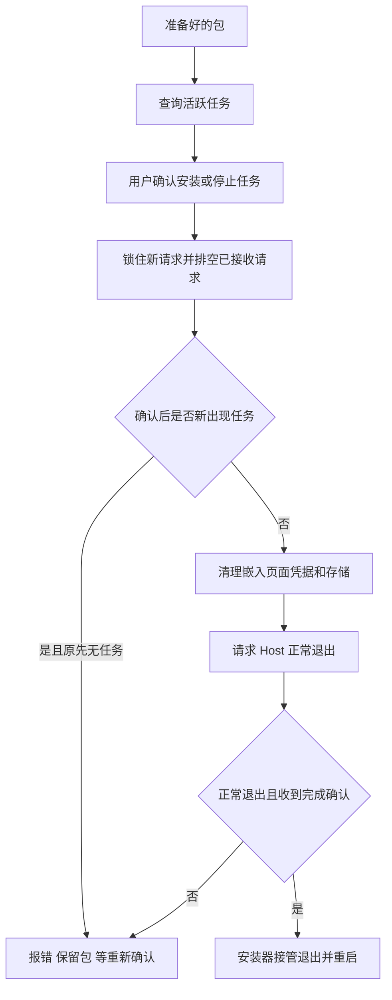

# DeepSeek 官方桌面客户端：更新、下载、缓存与恢复研究

日期：2026-09-27。范围：官方 `deepseek-ai/deepseek-harness` 的 `apps/desktop` 及它固定使用的更新依赖；不包括社区客户端。本次只读源码、测试与上游依赖，没有安装依赖、运行客户端、执行安装器或修改产品代码。

## 结论

官方可借鉴的重点是**把下载、校验、安装确认、任务停机和失败恢复串成一个受控状态机**，而不是简单替换下载 URL。其 Windows 差分下载确有实现与测试；没有证据表明它支持保留未完成片段、跨进程续传的下载管理器式断点续传。

“删除历史下载、只保留最新”只能作有限解释：更新库清理失效/失败的 `pending` 缓存，并复用完整下载；它另外保留差分基底，不是扫描所有下载目录或保证磁盘里永远只剩一个安装包。详见缓存章节。[协调器][coordinator]、[官方差分测试][diff-tests]、[缓存实现][cache-clear]。

| 问题 | 已核实结论 | 借鉴价值 |
|---|---|---|
| 检查更新是否直接下载？ | 否；`autoDownload=false`，用户确认版本后下载 | 保留用户对流量和更新时机的选择 |
| 退出客户端是否直接安装？ | 否；`autoInstallOnAppQuit=false`，另行确认安装 | 避免退出顺带安装和任务意外中断 |
| 100% 是否能安装？ | 100% 进入 `verifying`；更新库完成下载/校验准备才 `ready` | 明确区分下载完和可安装 |
| 多窗口/连点是否重复下载？ | 检查、下载、安装各共享一个进行中的 Promise | 防重复下载、防确认目标漂移 |
| 是否差分？ | Windows NSIS 开启差分包；用旧包和 blockmap 重建新包，失败退回整包 | 节约网络，但不等于加速解压/文件落盘 |
| 是否断点续传？ | 本次核查路径没有持久化片段续传；失败清理临时文件后重新请求 | 不应把 Range 或 `resume` 事件误称为续传 |
| 是否清理旧包？ | 有限清理 `pending`；差分基底保留，删除错误可能忽略 | 清理策略需要明确目录、时机和保留对象 |
| 安装前有任务怎么办？ | 检查并确认；锁住新请求、排空已接收请求、再检查，然后停 Host | 适合有 Agent/工具调用/后台任务的 GEA |
| 停机失败如何恢复？ | 拒绝安装；在确认旧 Host 已退出后重启 Host，保留已下载包，重新确认 | 减少失败后“客户端能开但后台不可用” |

以上表格来源分别见下文，不代表本次实机验收通过。

## 源码快照与实际发行包必须分开

主报告在本轮另行下载并校验的 Windows `0.1.7-rc.2` 发行包，内嵌 `dshBuildCommit=c1275515b6b97551ec358c926c479ab750c687c0`、`dshBuildDirty=false`；这与本文固定研究的公开 master SHA `477b4f4…` 不同。GitHub compare API 返回 404，尚不能证明两者逐字一致。因此本文的源码机制结论仅适用于公开 SHA；同版本号不能作为已发包等同源码的证据。发行包身份、feed、CDN 和物理文件统计由主报告保留实际测量记录，本报告未运行已发 Windows 安装/升级链。

## 固定来源与研究方法

- 官方快照：`477b4f420553e8a52c2fbccc464d7561b239c443`。所有官方链接固定此 SHA，不引用会漂移的 `master`。
- `pnpm-lock.yaml` 把 `electron-updater` 锁为 **6.8.9**，不是只看 package.json 中 `^6.8.9`。[锁文件][lock]
- 缓存和差分实现下沉更新库，因此额外核对其官方上游 `electron-userland/electron-builder`：标签 `electron-updater@6.8.9` 解引用到 commit `bed3a9c421a8a05c49f36a2af5d7ae3598cb1b95`。从 npm registry 读取对应发布包，`AppUpdater.ts`、`DownloadedUpdateHelper.ts`、`NsisUpdater.ts`、`BaseUpdater.ts` 四个源码映射与该 commit 文件逐字相同。[上游标签][upstream-tag]
- CodeGraph 对该快照返回没有 `.codegraph/` 索引，因此遵照工具限制改用原始源码定位；未初始化索引、未改研究对象。
- “有测试覆盖”在本文只表示读到了真实测试断言；本次未执行测试。官方记录报告通过与本次现场实测分开表述。

## 1. 更新检查与下载授权

`DesktopUpdateCoordinator` 集中拥有候选版本、下载就绪标记和当前操作。默认只在打包应用且存在 `app-update.yml` 时启用。它使用 `nightly` 频道、允许预发行，但显式关闭降级；检查还要求合法 semver 且目标高于本机安装版本。[协调器初始化][coordinator-init]、[版本判断][version-check]

三个关键约束：

1. 下载确认传入**所见版本号**，不接受 renderer 指定任意 URL；候选已改变就拒绝旧确认。
2. 下载中、安装中或准备好的版本存在时，检查不会换掉目标；并发请求合并。
3. 下载完成进入 `ready` 后还要单独确认安装。普通流程会主动打开安装确认；如果窗口隐藏，等它显示再问，取消后不会反复弹。[下载与安装][download-install]、[窗口隐藏处理][download-window]

单测不仅 mock 方法返回，还检查相位序列 `available → downloading → verifying → ready → installing`、并发只发一次、旧版本/非法版本拒绝、安装准备失败时不重下包。[协调器测试][coordinator-tests]

普通轮询基准 10 分钟，默认抖动 20%，失败指数退避最高默认 1 小时；采用完成时刻和单调时钟，手动检查可越过 deadline，合并请求只推进一次退避。主进程在前台/系统唤醒时调用同一节流入口；这里的 `resume` 是**电脑唤醒事件**。[轮询实现][schedule]、[前台与唤醒入口][resume-event]

## 2. 下载超时、失败和重试

它继承 Electron 原生 HTTP executor，以保留代理和认证行为，另外加**无响应超时**：默认 60 秒没有响应头或后续数据才中断；每次收到 bytes 刷新计时器，不把正常但较慢的大包按总时长杀掉。response end 后停止计时，校验阶段不会继续触发下载超时。[传输实现][http]、[传输测试][http-tests]

下载失败保持目标和可重试状态，后台轮询不会重新发下载；由用户显式重试。官方本地 HTTP fixture 覆盖 404、坏 hash、断线、停滞，另有在实际写入部分 bytes 后注入 `ENOSPC`，断言没有 `ready`、不允许安装、`exe/update-info.json` 被清理，恢复后再下载成功。[失败与磁盘写入测试][local-failures]

应区分三种“重试”：

| 行为 | 实际含义 |
|---|---|
| feed 检查自动退避 | 重试查询元数据，不自动重下失败安装包 |
| 差分失败后整包 fallback | 同一次用户授权内退回全量下载；可能多花一次 blockmap/Range 请求成本 |
| 临时文件 rename 的 EBUSY 重试 | 更新库对文件占用的有限重试（60 次、间隔 500ms），不是网络断点续传 |

底层先创建 `temp-*`，成功后 rename 为最终包；异常时清理 `pending`。再次创建同名临时包前先 unlink，未见保存已下载 offset/ETag 后接续写入的实现。因此不能声称有 HTTP 下载中断后的持久化 resume。[临时文件与失败清理][execute-download]、[临时文件创建][temp-file]

## 3. 差分下载：有实现，但不能泛化验收结果

Windows 打包配置为 NSIS，`differentialPackage: true`。更新库优先读取旧安装器基底及新旧 blockmap，通过 HTTP Range 拉变化部分，重建完整新安装器；旧 blockmap 优先取缓存，否则下载。任一差分异常返回全量路径。[Windows 配置][builder]、[NSIS 下载][nsis-download]、[差分算法入口][differential]

官方的 signed-download fixture 包含四种真实 HTTP 场景：

- multipart Range 重建；
- single Range 重建；
- 找不到旧 blockmap，退回整包；
- 服务端拒绝 Range，退回整包。

成功差分必须满足：**不存在 full fallback、所有 payload 请求带 Range、合计传输 bytes 小于完整包、重建后 SHA-512 正确且执行 Authenticode 检查**。这比只看日志出现“differential”更可靠。失败场景则要求恰有完整下载、最后一条 payload 大小等于整包。[官方差分测试][diff-tests]

限制：测试为 loopback，不能证明公司 OSS/CDN 的 Range、multipart、缓存代理行为，也不能证明安装后 cache 基底真实可用。官方验收记录明确写出这两个缺口。[官方验证边界][validation-limits]

macOS 更新库也有 `update.zip` 差分基底并复制新下载供未来复用，但 Windows 的上述签名/Range fixture 不能替代 macOS 已安装升级验收。[MacUpdater][mac-cache]

## 4. 缓存到底怎么清理

缓存不是用户 Downloads，也不是 GEA 插件历史版本目录。根位置来自应用 `baseCachePath + updaterCacheDirName`；待安装包放 `pending/`。[缓存位置][cache-location]

```text
<updater-cache>/
  installer.exe       Windows 差分输入基底（官方测试显式放入）
  current.blockmap    供后续差分使用
  pending/
    <目标安装包>.exe
    update-info.json 完整包的文件名、sha512、权限信息
    temp-<目标包>    传输中临时文件
```

上图是参与算法的文件角色，**不是任何时刻均保证存在或只存在这些文件的磁盘快照**。Windows 安装器如何写入根目录基底属于安装模板链路，本报告主要确证其下载端使用与官方测试输入；不能仅凭 fixture 认定真实安装缓存已验收。[缓存使用][differential]、[官方差分测试][diff-tests]

| 场景 | 底层源码行为 | 边界 |
|---|---|---|
| 同进程、同一已准备目标 | 核对版本/文件信息和存在性，复用 | 此快捷路径不重算完整 hash |
| 上次运行已完整下载 | 读取 `update-info.json`，比较 feed SHA-512，再计算文件 SHA-512；匹配就复用 | 这是完整包复用，不是未完成片段续传 |
| 缓存记录 SHA 与目标不同 | 清空 `pending` 后下载目标 | 不清空整个 cache 根目录 |
| 文件实际 hash 不符/部分元数据损坏 | 清空 `pending` | 删除异常被捕获忽略，不能作绝对空间保证 |
| metadata 不存在或包文件不存在 | 返回 cache miss | 并非每一类 cache miss 都执行全目录清理 |
| 下载异常/签名拒绝 | 清理 `pending`，移除最终目标残留 | official fixture 断言拒绝的 exe 被移除 |
| 换了一个更高版本但当前包已 ready | 协调器保持当前目标 | 不会发现更新 feed 就立即删掉用户已确认的包 |

依据：[完整缓存复用][cache-validation]、[清空目录][cache-clear]、[下载清理][execute-download]、[签名拒绝测试][signature-tests]、[锁定已准备版本][coordinator]。

因此准确结论是：**有按目标替换和失败清理的 pending 缓存策略；有刻意保留的差分基底；没有在所核查链路发现按容量、天数、历史版本数量运行的通用 GC，也不能保证清理永远成功。**它不是“历史下载一概删除、只留最新”的产品功能。[缓存实现][cache-validation]

另外，官方文档提到的 `cache:windows-signatures`、macOS signing cache 是**构建/签名缓存**，不能拿来当终端用户更新缓存的证明。

## 5. SHA-512 与签名是两层检查

下载传输/重建使用 feed 的 SHA-512 验完整性；Windows 随后验证安装包 Authenticode 发布者。官方构建从公开签名证书提取 CN、O、C，缺任意一项失败，把预期 publisher 写入打包配置；从已安装 app-update.yml 读取预期值，而不是由新 feed 自己指定发布者。[构建配置][builder]、[发布者提取][publisher]、[NSIS 校验][nsis-signature]

这个配置不能漏：底层在 publisherName 缺失时会跳过签名检查，不会自动拒绝。官方也有 missing-publisher negative control；接入 GEA 时需要同时迁移打包约束和测试，不能只引入 `electron-updater` 就宣称具备签名校验。[NSIS 校验][nsis-signature]、[官方签名记录][signature-record]

官方真实下载 fixture 验证：hash 正确但 publisher 错误拒绝、无签名拒绝、bytes 损坏在签名检查前拒绝；拒绝后不会 ready/安装，并清理 exe 缓存，恢复正确签名后显式重试才成功。[签名下载测试][signature-tests]

## 6. 安装前与活跃任务协调、失败恢复

下载本身不停止任务。安装时的顺序由 `main.ts` 控制：[安装前协调][pre-restart]



任务包括 running agent（含子 Agent、工具/审批等待所处 running 状态）、下一轮/下一步消息队列，以及全局或 agent 所属 running/stopping 后台 job。lock 后新 API 请求收到 503，已经进入的请求等待结束后再看任务；锁世代和 stopped 标记防止已取消的排空操作迟到后仍生效。[Host 请求与任务保护][task-control]、[任务竞态测试][task-tests]

Host 控制请求有 10 秒 deadline。停机先给正常 shutdown 10 秒，再 SIGTERM 5 秒，之后 SIGKILL 再等 5 秒；**进程被强杀而退出不等于允许安装**，强制退出、非零退出码、没收到 shutdown 完成确认都会拒绝 handoff。[停机实现][host-stop]

准备失败但 Host 尚未停：尝试 unlock；确认 Host 已停且安装准备失败：启动替代 Host、重新导航页面以拿新端口/cookie/boot 数据。已下载包保持；重试安装仍需新的确认。官方真实 Electron/Host fixture 断言停机超时不调用安装器、随后 Host 恢复，强制更新政策也不会因此被错误清除。[恢复实现][recover]、[恢复测试][recover-tests]

普通退出与更新退出分开：安装器已获确认时设置 `shellInstallerOwnsQuit`，不叠加一次普通退出确认。普通退出任务查询失败按未知活跃处理，避免静默退出；多次退出共用一个确认。[退出实现][quit-confirm]、[安装器接管退出][installer-quit]

这个恢复是**安装前/安装 handoff 失败的工作区恢复**；不能因此声称已经实现安装落盘后新程序坏掉自动回退旧版本。那需要另查安装器/启动健康检查与实机证据。

## 7. 对 GEA 的建议（方案，未实施）

GEA 当前整包 SHA-256 下载后定位安装包、插件更新独立依赖图和 rollback 的情况由主报告核对，本报告不重复把它作为本轮实测结论。建议按收益与迁移成本分层：

| 优先级 | 建议 | 必要验证 |
|---|---|---|
| 第一批 | 明确 downloading / verifying / ready / installing / error；合并并发请求；绑定确认时版本 | 连点、旧确认、feed 被替换、100% 后校验失败 |
| 第一批 | 临时文件+校验后改名、完整包复用、失败残留清理、空闲超时和明确手动重试 | 断网、无响应、损坏 hash、磁盘写失败、文件被占用 |
| 第一批 | 定义缓存目录及保留清单：当前完整待安装包、必要回滚/差分基底，其余按规则清理 | 所有删除只作用于自有目录；不能删正在下载/使用的包；删除失败应可诊断 |
| 第二批 | 自动调用安装器前建立任务检查、确认、锁请求、排空、正常停机和 Host 恢复 | 确认窗口期间出现任务、停机超时、退出取消、失败后再次安装 |
| 第二批 | 为 Windows 发布者验证建立打包协议和负向测试 | 正确 hash+错误 publisher、无签名、publisher 配置缺失 |
| 有数据再做 | blockmap 差分+全量回退 | 公司 OSS/CDN Range、基底可用率、实际节省 bytes、各版本升级跨度 |
| 独立需求 | 若用户确实要暂停后继续或跨重启续传，单独设计持久化 partial+ETag/If-Range 协议 | 不可把差分成功当作续传验收；对象变化必须拒绝混拼 |

不要为了“只留最新”提前删掉当前仍需安装的包、回滚资源或差分基底。缓存清理、安装升级、插件回滚是不同生命周期，应分别指定保留条件。

## 8. 已确认与未覆盖

**已确认**：固定官方源码；lock 对应真实依赖源码；状态机、超时、差分/回退、缓存处理、Windows 发布者约束、任务锁/停机/恢复；存在相应真实 HTTP 与 Electron/Host fixture 断言。

**未覆盖**：本机或 Windows 实机运行这些测试；真实发行 CDN 的 Range 与实际网速；真实磁盘耗尽；完整安装覆盖后自动启动/数据保留；macOS 完整安装链；更新落盘后程序损坏的 rollback；GEA 原有安装器是否可直接兼容更新库协议。

官方自己的验收记录也保留安装后启动、自动重启、数据保留、真实已安装差分路径等未完成项。本文不把测试脚本存在或 README 的局部通过扩大成“官方全链路已验收”。[官方验证边界][validation-limits]


## 固定链接索引

[coordinator]: https://github.com/deepseek-ai/deepseek-harness/blob/477b4f420553e8a52c2fbccc464d7561b239c443/apps/desktop/src/update-coordinator.ts#L14-L140
[coordinator-init]: https://github.com/deepseek-ai/deepseek-harness/blob/477b4f420553e8a52c2fbccc464d7561b239c443/apps/desktop/src/update-coordinator.ts#L49-L74
[version-check]: https://github.com/deepseek-ai/deepseek-harness/blob/477b4f420553e8a52c2fbccc464d7561b239c443/apps/desktop/src/update-coordinator.ts#L178-L189
[download-install]: https://github.com/deepseek-ai/deepseek-harness/blob/477b4f420553e8a52c2fbccc464d7561b239c443/apps/desktop/src/update-coordinator.ts#L84-L140
[download-window]: https://github.com/deepseek-ai/deepseek-harness/blob/477b4f420553e8a52c2fbccc464d7561b239c443/apps/desktop/src/main.ts#L598-L608
[coordinator-tests]: https://github.com/deepseek-ai/deepseek-harness/blob/477b4f420553e8a52c2fbccc464d7561b239c443/apps/desktop/tests/update-coordinator.spec.ts#L131-L210
[lock]: https://github.com/deepseek-ai/deepseek-harness/blob/477b4f420553e8a52c2fbccc464d7561b239c443/pnpm-lock.yaml#L573-L584
[schedule]: https://github.com/deepseek-ai/deepseek-harness/blob/477b4f420553e8a52c2fbccc464d7561b239c443/apps/desktop/src/update-schedule.ts#L18-L110
[resume-event]: https://github.com/deepseek-ai/deepseek-harness/blob/477b4f420553e8a52c2fbccc464d7561b239c443/apps/desktop/src/main.ts#L863-L871
[http]: https://github.com/deepseek-ai/deepseek-harness/blob/477b4f420553e8a52c2fbccc464d7561b239c443/apps/desktop/src/update-http-executor.ts#L5-L51
[http-tests]: https://github.com/deepseek-ai/deepseek-harness/blob/477b4f420553e8a52c2fbccc464d7561b239c443/apps/desktop/tests/update-http-executor.spec.ts#L16-L69
[local-failures]: https://github.com/deepseek-ai/deepseek-harness/blob/477b4f420553e8a52c2fbccc464d7561b239c443/apps/desktop/tests/fixtures/local-updater.mjs#L152-L215
[builder]: https://github.com/deepseek-ai/deepseek-harness/blob/477b4f420553e8a52c2fbccc464d7561b239c443/apps/desktop/scripts/electron-builder-config.mjs#L221-L247
[diff-tests]: https://github.com/deepseek-ai/deepseek-harness/blob/477b4f420553e8a52c2fbccc464d7561b239c443/apps/desktop/tests/fixtures/signed-updates.mjs#L118-L155
[signature-tests]: https://github.com/deepseek-ai/deepseek-harness/blob/477b4f420553e8a52c2fbccc464d7561b239c443/apps/desktop/tests/fixtures/signed-updates.mjs#L71-L117
[publisher]: https://github.com/deepseek-ai/deepseek-harness/blob/477b4f420553e8a52c2fbccc464d7561b239c443/apps/desktop/scripts/windows-sign.mjs#L76-L94
[signature-record]: https://github.com/deepseek-ai/deepseek-harness/blob/477b4f420553e8a52c2fbccc464d7561b239c443/apps/desktop/tests/README.md#L68-L72
[pre-restart]: https://github.com/deepseek-ai/deepseek-harness/blob/477b4f420553e8a52c2fbccc464d7561b239c443/apps/desktop/src/main.ts#L546-L593
[task-control]: https://github.com/deepseek-ai/deepseek-harness/blob/477b4f420553e8a52c2fbccc464d7561b239c443/apps/desktop-host/src/update-tasks.ts#L8-L60
[task-tests]: https://github.com/deepseek-ai/deepseek-harness/blob/477b4f420553e8a52c2fbccc464d7561b239c443/apps/desktop/tests/host-update-tasks.spec.ts#L85-L144
[host-stop]: https://github.com/deepseek-ai/deepseek-harness/blob/477b4f420553e8a52c2fbccc464d7561b239c443/apps/desktop/src/host-process.ts#L237-L306
[recover]: https://github.com/deepseek-ai/deepseek-harness/blob/477b4f420553e8a52c2fbccc464d7561b239c443/apps/desktop/src/main.ts#L497-L516
[recover-tests]: https://github.com/deepseek-ai/deepseek-harness/blob/477b4f420553e8a52c2fbccc464d7561b239c443/apps/desktop/tests/fixtures/workspace-updates.mjs#L322-L382
[quit-confirm]: https://github.com/deepseek-ai/deepseek-harness/blob/477b4f420553e8a52c2fbccc464d7561b239c443/apps/desktop/src/quit-confirmation.ts#L10-L94
[installer-quit]: https://github.com/deepseek-ai/deepseek-harness/blob/477b4f420553e8a52c2fbccc464d7561b239c443/apps/desktop/src/main.ts#L1203-L1214
[validation-limits]: https://github.com/deepseek-ai/deepseek-harness/blob/477b4f420553e8a52c2fbccc464d7561b239c443/apps/desktop/tests/README.md#L68-L85
[cache-clear]: https://github.com/electron-userland/electron-builder/blob/bed3a9c421a8a05c49f36a2af5d7ae3598cb1b95/packages/electron-updater/src/DownloadedUpdateHelper.ts#L82-L97
[cache-validation]: https://github.com/electron-userland/electron-builder/blob/bed3a9c421a8a05c49f36a2af5d7ae3598cb1b95/packages/electron-updater/src/DownloadedUpdateHelper.ts#L38-L153
[temp-file]: https://github.com/electron-userland/electron-builder/blob/bed3a9c421a8a05c49f36a2af5d7ae3598cb1b95/packages/electron-updater/src/DownloadedUpdateHelper.ts#L182-L200
[execute-download]: https://github.com/electron-userland/electron-builder/blob/bed3a9c421a8a05c49f36a2af5d7ae3598cb1b95/packages/electron-updater/src/AppUpdater.ts#L709-L799
[cache-location]: https://github.com/electron-userland/electron-builder/blob/bed3a9c421a8a05c49f36a2af5d7ae3598cb1b95/packages/electron-updater/src/AppUpdater.ts#L690-L705
[differential]: https://github.com/electron-userland/electron-builder/blob/bed3a9c421a8a05c49f36a2af5d7ae3598cb1b95/packages/electron-updater/src/AppUpdater.ts#L801-L886
[nsis-download]: https://github.com/electron-userland/electron-builder/blob/bed3a9c421a8a05c49f36a2af5d7ae3598cb1b95/packages/electron-updater/src/NsisUpdater.ts#L43-L80
[nsis-signature]: https://github.com/electron-userland/electron-builder/blob/bed3a9c421a8a05c49f36a2af5d7ae3598cb1b95/packages/electron-updater/src/NsisUpdater.ts#L109-L123
[mac-cache]: https://github.com/electron-userland/electron-builder/blob/bed3a9c421a8a05c49f36a2af5d7ae3598cb1b95/packages/electron-updater/src/MacUpdater.ts#L103-L136
[upstream-tag]: https://github.com/electron-userland/electron-builder/releases/tag/electron-updater%406.8.9
